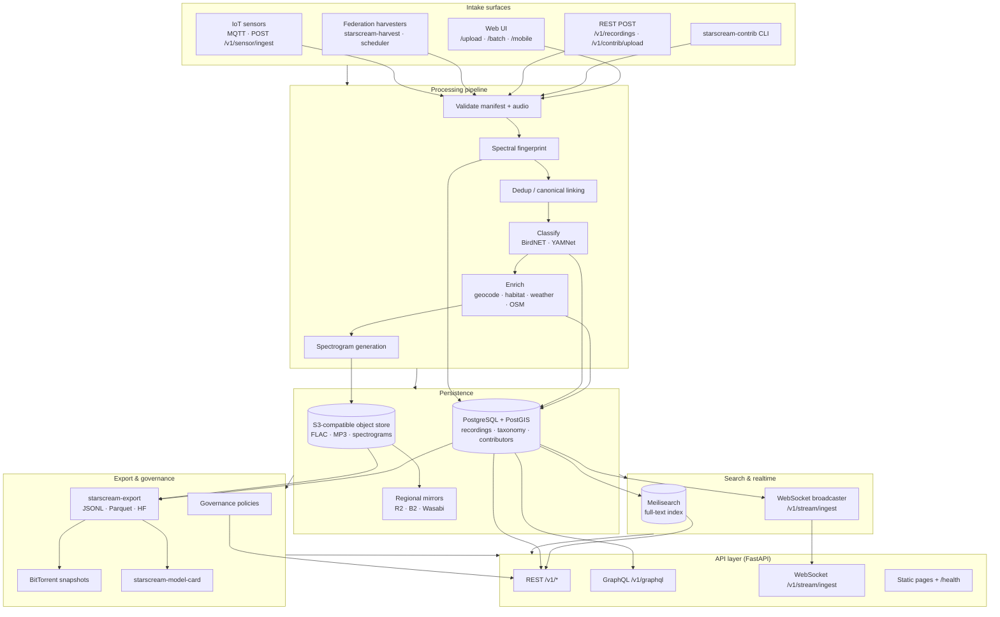

# Starscream Architecture

Starscream is an open acoustic corpus platform: contributors, federated archives, and IoT sensor nodes ingest grounded sound recordings; a processing pipeline validates, fingerprints, classifies, enriches, stores, and indexes them; researchers export datasets for ML training.

## System diagram

## Module map

| Package | Role |
|---------|------|
| `starscream/api/` | FastAPI app, REST routes, GraphQL schema, WebSocket stream, auth middleware, rate limiting |
| `starscream/contrib/` | Contribution framework: manifest schema, validator, batch ZIP handling, `starscream-contrib` CLI |
| `starscream/pipeline/` | Intake processing: validate → fingerprint → dedup → classify → enrich → store → index |
| `starscream/federation/` | External archive connectors (Freesound, Xeno-canto, iNaturalist, Internet Archive, NOAA, NASA) and `starscream-harvest` CLI |
| `starscream/sensor/` | IoT sensor node registration, MQTT handler, HTTP ingest |
| `starscream/storage/` | S3-compatible audio/spectrogram I/O and regional mirror replication |
| `starscream/export/` | Dataset builder (JSONL, Parquet, Hugging Face), HF publish, BitTorrent snapshots |
| `starscream/db/` | SQLAlchemy models, session factory, Alembic migrations |
| `starscream/jobs/` | Batch harvest (`harvest_all`) and scheduled harvest daemon (`scheduler`) |
| `starscream/governance/` | Foundation policies, rate tiers, model-card attribution clause |
| `starscream/tools/` | `starscream-model-card` generator |
| `starscream/events.py` | In-process ingest event broadcaster for WebSocket subscribers |
| `starscream/static/` | Web UI pages (explore, upload, recording detail, stats, batch, mobile, stream) |
| `starscream/seed/` | Bootstrap taxonomy tree and federation source records |

## Data flow: intake → store → index → export

### 1. Intake

Three primary paths converge on the same pipeline core:

**Contributions** — manifest JSON + raw audio via web form, `starscream-contrib upload`, or `POST /v1/contrib/upload`. The contrib path runs `submit_contribution()`: strict manifest validation, FLAC/MP3 normalization, spectrogram pre-generation, scene-graph fields, and contributor attribution.

**Federation** — `starscream-harvest`, `POST /v1/federation/harvest/{slug}`, or the scheduler daemon pull pages from external APIs. Connectors map remote records to Starscream schema; CC-BY-NC and pointer-only licenses are enforced (metadata + external URL, no audio storage).

**Sensors** — registered nodes publish via MQTT or `POST /v1/sensor/ingest` with `X-Node-Token` or contributor API key.

**Direct REST** — `POST /v1/recordings` accepts multipart form fields for lightweight programmatic ingest (used by integrations and tests).

### 2. Validate & fingerprint

- `pipeline/validate.py` — coordinates, timestamps, license policy, audio presence rules.
- `pipeline/fingerprint.py` — spectral hash for deduplication.
- `pipeline/dedup.py` — links duplicates to a canonical recording; cross-source dedup for federation.

### 3. Classify & enrich

- `pipeline/classify.py` — BirdNET (wildlife) and YAMNet (general) classifiers; results stored in `recording_classifications`.
- `pipeline/enrich.py` — reverse geocode (Nominatim), habitat, weather, and OSM Overpass cross-modal links.
- `pipeline/spectrogram.py` — PNG spectrogram; cached in object store on first request or at ingest.

### 4. Store

- **PostgreSQL + PostGIS** — recording metadata, taxonomy, contributors, reviews, flags, harvest runs, sensor nodes. Geo queries use `ST_DWithin` / `ST_MakePoint`.
- **S3-compatible object store (MinIO locally)** — `flac/{uuid}.flac`, `mp3/{uuid}.mp3`, spectrogram PNGs. Optional `MIRROR_ENDPOINTS` replicate to R2/B2/Wasabi.

### 5. Index

- `pipeline/index.py` — upserts searchable document into Meilisearch (`recordings` index).
- `events.py` — publishes ingest summaries to WebSocket subscribers filtered by taxonomy prefix or geo radius.

### 6. Export

- `export/builder.py` — queries Postgres, optionally downloads audio from S3, writes JSONL/Parquet/Hugging Face datasets with train/val splits.
- `export/publish.py` — pushes export directory to Hugging Face Hub.
- `export/torrent.py` — creates BitTorrent snapshot manifests.
- `tools/model_card.py` — generates attribution-compliant model cards from `export_meta.json`.

## API surfaces

### REST (`/v1/*`)

Versioned JSON API mounted at `/v1`. See [API_SURFACE.md](./API_SURFACE.md) for the full endpoint table.

Key route groups: `recordings`, `contrib`, `search`, `taxonomy`, `sources`, `stats`, `contributors`, `reviews`, `federation`, `sensor`, `admin`, `governance`.

Authentication:
- Contributor uploads: `X-API-Key` or `Authorization: Bearer` on `POST /v1/contrib/*` (except register/validate).
- Sensor ingest: `X-Node-Token` or contributor API key on `POST /v1/sensor/ingest`.
- Admin: `X-API-Key` matching `ADMIN_API_KEY` on `GET /v1/admin/*`.

Rate limiting: sliding window per client IP (`API_RATE_LIMIT_PER_MIN`, default 1000/min). Headers: `X-RateLimit-Limit`, `X-RateLimit-Remaining`.

### GraphQL

Requires optional dependency: `pip install -e ".[graphql]"`.

| URL | Purpose |
|-----|---------|
| `POST /v1/graphql` | Production GraphQL endpoint (no IDE) |
| `POST /graphql` | GraphQL endpoint with Strawberry IDE |

Queries: `recordings` (spatial/temporal filters), `recording(id)`, `search(q)`, `stats`.

### WebSocket

| URL | Purpose |
|-----|---------|
| `WS /v1/stream/ingest` | Real-time ingest feed |

Clients connect and optionally send a filter (`taxonomy_prefix`, `lat`, `lng`, `radius_km`) via query string or first JSON message. Server responds with `{"type":"subscribed","filter":{...}}` then `{"type":"ingest","recording":{...}}` for each new recording. Live demo page: `/stream`.

### Web UI & ops

| URL | Purpose |
|-----|---------|
| `/explore` | Full-text search browser |
| `/upload` | Single contribution form |
| `/batch` | ZIP batch upload |
| `/mobile` | Offline-capable mobile recorder |
| `/recording?id=UUID` | Recording detail (audio, spectrogram, classifications) |
| `/stats` | Corpus statistics dashboard |
| `/contributors-page` · `/leaderboard` | Contributor profiles and rankings |
| `/health` | Dependency health probe (Postgres, Meilisearch, S3) |
| `/docs` | Swagger UI (auto-generated) |
| `/docs/{path}` | Served markdown docs from `docs/` |

## Infrastructure (local dev)

`docker compose up -d` starts:

| Service | Port | Purpose |
|---------|------|---------|
| PostgreSQL + PostGIS | 5432 | Primary database |
| Meilisearch | 7700 | Full-text search |
| MinIO (S3 API) | 9000 | Object storage |
| MinIO Console | 9001 | Storage admin UI |

Production stack (`docker-compose.prod.yml`) adds the API container, optional MQTT broker (profile `mqtt`, port 1883), and health checks.

## External dependencies

| Dependency | Used by |
|------------|---------|
| Nominatim | Reverse geocoding during enrichment |
| Open-Meteo / weather APIs | Weather enrichment |
| OSM Overpass | Cross-modal scene links |
| Freesound API | Federation harvest (requires `FREESOUND_API_KEY`) |
| Hugging Face Hub | Dataset publish (`HF_TOKEN`) |

## Related docs

- [API_SURFACE.md](./API_SURFACE.md) — complete endpoint reference
- [CONTRIBUTING.md](./CONTRIBUTING.md) — contribution guidelines
- [EXPORT.md](./EXPORT.md) — dataset export formats
- [FEDERATION.md](./FEDERATION.md) — harvest connectors
- [STORAGE.md](./STORAGE.md) — object store and mirrors
- [GOVERNANCE.md](./GOVERNANCE.md) — Foundation policies
- [SENSOR.md](./SENSOR.md) — IoT node reference design
- [DEPLOY.md](./DEPLOY.md) — production deployment
